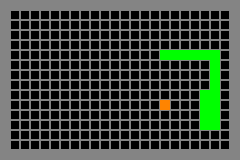

<div align="center">

# Snake GBA

**A classic Snake game built from scratch in C for the Game Boy Advance — no game engine required.**

[](https://en.wikipedia.org/wiki/Game_Boy_Advance)
[](https://en.wikipedia.org/wiki/C_(programming_language))
[](LICENSE)
[](https://asdeph.itch.io/snake-gba)



</div>

---

## Overview

**Snake GBA** is a homebrew Game Boy Advance game developed to explore low-level game programming without an engine. Written in C using the **TONC** library and **devkitARM**, it renders directly to the GBA's bitmap display in Mode 3 (`240×160`) on a `24×16` grid of `10×10` pixel cells.

### Features

- **Mode 3 Bitmap Rendering** — Direct pixel/rectangle drawing on a bordered `24×16` playfield.
- **Doubly-Linked List Snake** — Dynamic segment management (`snakehead` / `snaketail`) for smooth growth and movement.
- **VSync-Paced Game Loop** — Synchronized to GBA vertical blanking (`vid_vsync()`) at 1 game step every 10 hardware frames.
- **U-Turn Prevention** — Input handling prevents instant 180° self-collisions on directional changes.
- **Collision & Auto-Restart** — Detects wall, self, and food collisions, clearing and resetting the board on game over.

---

## Play Online / Download ROM

You can download the compiled `.gba` ROM via **[itch.io](https://asdeph.itch.io/snake-gba)**.

---

## Controls

| Input | Action |
| :--- | :--- |
| **D-Pad (Up / Down / Left / Right)** | Steer the snake |

---

## Building from Source

### Prerequisites

- [**devkitPro / devkitARM**](https://devkitpro.org/wiki/Getting_Started) (with `libgba` and `gba_rules`)
- [**TONC**](https://www.coranac.com/tonc/text/toc.htm) (`tonclib` and `tonc_rules`)
- `make`
- A GBA emulator such as [mGBA](https://mgba.io/) (or a flashcart for real hardware)

### Environment Setup

Ensure the following environment variables are configured before building:

```bash
export DEVKITARM=/path/to/devkitARM
export TONCCODE=/path/to/tonc-code/code
```

> **Note:** If `TONCCODE` is not set, the `Makefile` defaults to `D:/PPs/tonc-code/code`.

### Build Commands

```bash
# Clone the repository
git clone https://github.com/aryanisran/snakegba.git
cd snakegba

# Build the release ROM (outputs snakegba.gba)
make

# Build with debug symbols
make DEBUG=1

# Clean build artifacts
make clean
```

Load the generated `snakegba.gba` file in your preferred GBA emulator or flashcart.

---

## Project Structure

```text
snakegba/
├── images/
│   └── GBA.gif             # Gameplay preview
├── include/
│   ├── food.h              # Food spawning declarations
│   ├── game.h              # Core game loop & state declarations
│   ├── Intellisense.h      # IDE IntelliSense helpers
│   ├── object.h            # 2D grid object & drawing primitives
│   └── snake.h             # Doubly-linked list snake structures & API
├── source/
│   ├── food.c              # Random food placement
│   ├── game.c              # Grid setup, input polling, update loop
│   ├── main.c              # GBA Mode 3 initialization & entry point
│   ├── object.c            # Mode 3 rectangle/frame rendering
│   └── snake.c             # Snake movement, growth, & collision logic
├── LICENSE                 # GNU General Public License v3.0
├── Makefile                # devkitARM / TONC build configuration
└── README.md
```

---

## Acknowledgements

- [**TONC**](https://www.coranac.com/tonc/text/toc.htm) — Comprehensive GBA programming tutorial and `libtonc` library.
- [**GBA_VSCode_Basic**](https://github.com/JamieDStewart/GBA_VSCode_Basic) — VS Code project template and environment setup guide.

---

## License

This project is licensed under the **GNU General Public License v3.0** — see the [LICENSE](LICENSE) file for details.
